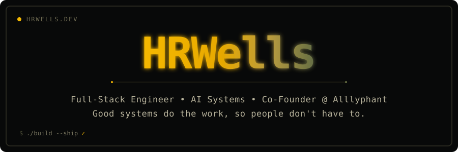

<div align="center">



<br>

# Hi, I'm Shubham 👋

**Full-Stack Software Engineer · AI Engineer · Co-Founder at [Alllyphant](https://www.alllyphant.com)**

I build websites, web apps, CRMs, automations and AI systems that help businesses grow,<br>
from the first pixel to the production server.

<br>

<a href="https://hrwells.dev/"></a>
<a href="https://www.alllyphant.com"></a>
<a href="https://www.linkedin.com/in/shubham-kadam-0620b722a/"></a>
<a href="mailto:kadamshubham10246@gmail.com"></a>
<a href="https://t.me/h_r_wells"></a>

</div>

---

## `whoami`

```bash
$ whoami
hrwells  # Shubham Kadam · Mumbai, India

$ cat about.txt
Co-Founder @ Alllyphant: technology, systems & data
Full-Stack Engineer:  Next.js · TypeScript · Node.js · PostgreSQL
AI Engineer:          LLM apps · AI agents · RAG · MCP servers · automation
Ships to production:  Docker · Linux · Nginx · CI/CD · VPS

$ echo $MOTTO
Good systems do the work, so people don't have to.
```

---

## 🐘 Now: Alllyphant

<table>
<tr>
<td width="60%" valign="top">

I co-founded **[Alllyphant](https://www.alllyphant.com)**, a Mumbai-based **growth partner** for small and mid-sized businesses.
We fix the places where growth leaks: businesses that are **not found, not trusted, not contacted, or not followed up**.

My side is **technology, systems and data**:

- **Lead-focused websites** with SEO, local SEO, **AEO & GEO** (answer & generative engine optimization)
- **Custom CRMs**, lead capture, routing and follow-up
- **Business process automation** and API integrations (WhatsApp, Telegram, email)
- **Dashboards & analytics** so owners see what's happening
- **AI-powered workflows** that take repetitive work off people's hands

</td>
<td width="40%" valign="top">

**Recent client work**

| Project | Type |
| --- | --- |
| [alllyphant.com](https://www.alllyphant.com) | Agency site · Next.js 15 |
| [Yashodhan Associates](https://yashodhanassociates.com) | PMC site + CMS |
| [Beyond Basics](https://bbc.hrwells.dev) | Custom e-commerce + admin |
| [Mahasagar](https://mahasagar.hrwells.dev) | Restaurant site |
| [Hightech Plast](https://hightechplast.com) | Company site |
| [SoVi Interiors](https://sovi.design) | Landing page |

</td>
</tr>
</table>

---

## 🤖 AI Engineering

I build practical **AI systems**, not demos: tools that run every day on real work.

<table>
<tr>
<td width="50%" valign="top">

### What I work with

- **LLM integration**: Claude API (Anthropic), OpenAI API
- **AI agents & agentic workflows**: multi-agent orchestration, tool calling
- **MCP (Model Context Protocol)** servers for custom tools and data
- **RAG**: hybrid search (keyword + semantic / vector embeddings)
- **Speech-to-text** with Whisper, AI voice-over (ElevenLabs)
- **Prompt engineering** and evals
- **AI-assisted development** with Claude Code

</td>
<td width="50%" valign="top">

### What I've built with it

- **HRRecall**: private RAG search engine over projects, notes and docs, served to AI agents as an MCP tool
- **HRNexus**: live control panel for AI coding agents (sessions, tools, approvals) with mobile + Telegram approvals
- **HRLeaf MCP**: a notebook app with an MCP server, so AI agents can read and write notes
- **meetrec**: records calls, transcribes them locally with Whisper, AI writes the meeting notes
- **AI video pipeline**: motion-graphics reels with Remotion + AI voice-over

</td>
</tr>
</table>

---

## ⚡ What I Build

<table>
<tr>
<td width="50%" valign="top">

### 🌐 Web Apps & Websites
Next.js · React · TypeScript · Tailwind CSS · SEO / AEO / GEO · Core Web Vitals · Auth · Payments · Webhooks · CMS

</td>
<td width="50%" valign="top">

### ⚙️ Backend & APIs
Node.js · Express · Bun · Prisma · PostgreSQL · MongoDB · REST APIs · File uploads · Background jobs · Telegram & WhatsApp bots

</td>
</tr>
<tr>
<td width="50%" valign="top">

### 📱 Mobile Apps
React Native · Expo · Android · Push notifications · API integrations

</td>
<td width="50%" valign="top">

### 🚀 DevOps & Infrastructure
Linux · Docker · Nginx · PM2 · VPS hosting · GitHub Actions · CI/CD · Vercel · Uptime monitoring

</td>
</tr>
</table>

---

## 🧰 Tech Stack

<div align="center">

**Frontend**<br>


**Backend & Data**<br>


**AI & Automation**<br>


**Mobile**<br>


**DevOps & Tools**<br>


</div>

---

## 📊 GitHub Activity

<div align="center">





</div>

---

## 🐍 Contribution Graph

<div align="center">

<picture>
  <source media="(prefers-color-scheme: dark)" srcset="./profile/github-snake-dark.svg"/>
  <source media="(prefers-color-scheme: light)" srcset="./profile/github-snake.svg"/>
  
</picture>

</div>

---

## 💻 Developer Mode



---

## 🎯 Philosophy

> Build it. Break it. Understand it. Fix it. Ship it.

I learn by **building real things**, solving real problems, and improving the systems behind them.

---

<div align="center">

### Let's build something.

<a href="https://hrwells.dev/"></a>
<a href="https://www.alllyphant.com"></a>
<a href="mailto:kadamshubham10246@gmail.com"></a>

<br><br>


</div>
